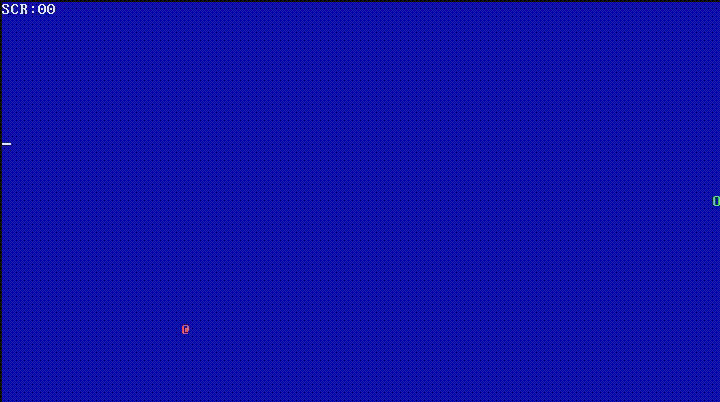

# snake.asm

A snake game that fits into a single 512-byte boot sector, written in x86 real mode assembly.

# Demo



# How to play

## Requirements
You need to have `nasm` and `qemu` installed on your system.

## Clone Repo
```bash
git clone https://github.com/R4405U/snake.asm
cd snake.asm
```

## Compile Game
```bash
nasm -f snake.asm -o snake.bin
```

## Run Game
```bash
qemu-system-x86_64 -drive format=raw,file=snake.bin
```
